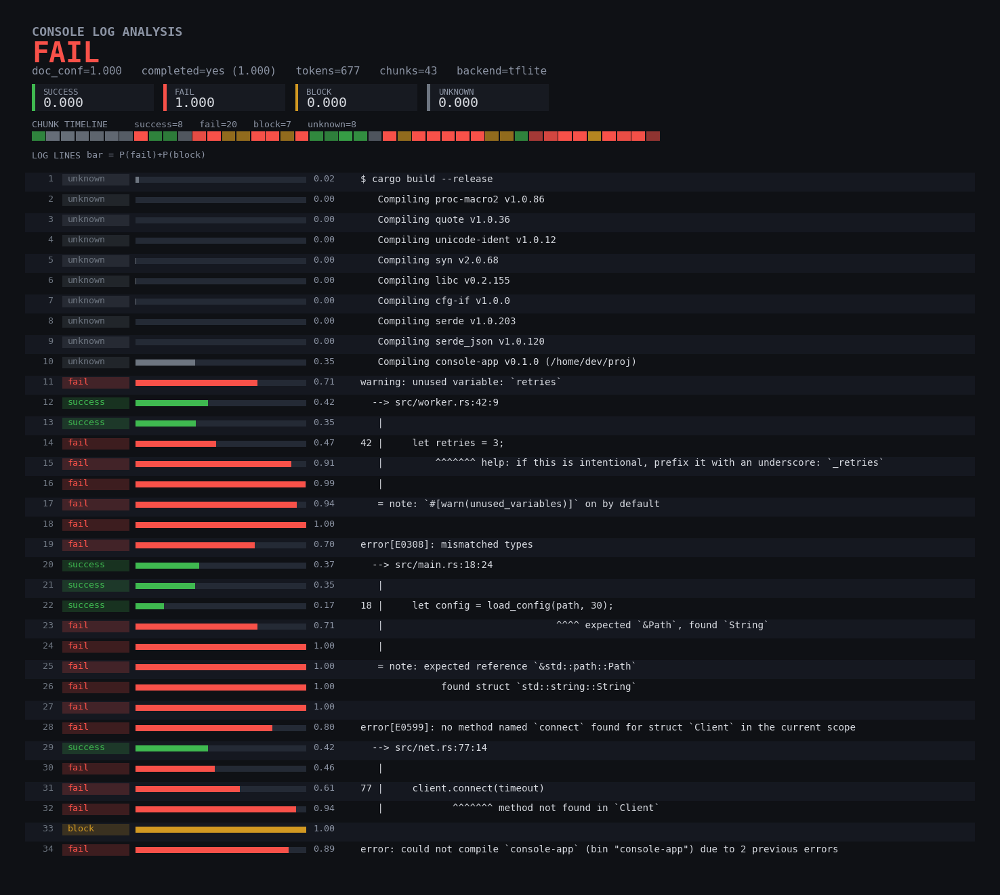
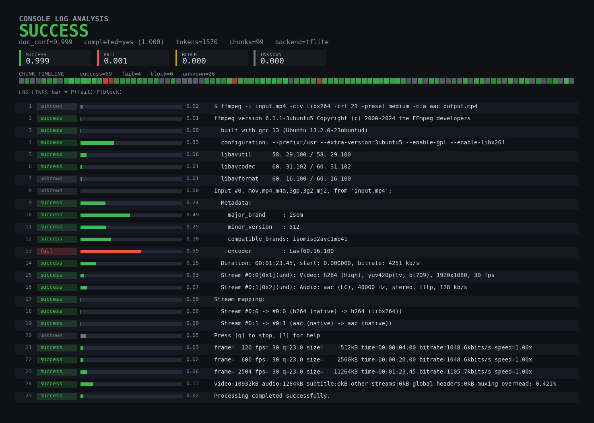

# console-nn

[](https://www.python.org/)
[](https://www.tensorflow.org/)
[](LICENSE)
[](tests/)

Length-unlimited console-log classification with a small fully-convolutional
network. The model labels 16-token chunks (`success` / `fail` / `block` /
`unknown`), pools them into a document verdict, and predicts whether the
operation reached a terminal state.

The int8 TFLite model accepts `[1, C, 16]` with dynamic `C`; Keras processes the
whole document. No recurrent or attention state. CPU-first.

```python
from console_nn import analyze

result = analyze(open("build.log").read(), tflite=True)
print(result.status, result.confidence, result.completed)
print(result.to_brief())
```

## Results

All three checkpoints were retrained on the cleaned mixed corpus. `base` was
stopped from its best checkpoint; its epoch count is not recorded.

| variant | vocab | params | fp32 | int8 | float doc | int8 doc | int8 chunk | latency / 2048 tokens |
|---|---:|---:|---:|---:|---:|---:|---:|---:|
| `base` | 5000 | 506,953 | 1.93 MB | 600 KB | **99.14%** | **99.18%** | 67.22% | 11.041 ms |
| `cpu` | 3000 | 138,665 | 0.53 MB | **180 KB** | **99.05%** | **99.05%** | 67.07% | **2.358 ms** |
| `rms` | 3000 | 163,305 | 0.62 MB | 220 KB | 98.85% | 98.85% | 66.82% | 5.877 ms |

- CPU: AMD Ryzen 7 5700X, 4 TFLite threads, 200 iterations.
- `cpu`: 15 epochs, 503.9 s training, 869k tokens/s at inference.
- Real held-out test (39 sessions): **94.87% document accuracy**, 70.67%
  macro-F1, 58.22% chunk accuracy, 84.62% completion accuracy.
- Metrics: `artifacts/<variant>/metrics.json`; training log: `run.log`.

## Examples

Each visual example is one log and one generated PNG:

| success: pip install | failure: pytest |
|---|---|
| [](examples/logs/01-pip-install-success.log) | [](examples/logs/02-pytest-failure.log) |

| blocked: apt lock | failure: cargo build |
|---|---|
| [](examples/logs/03-apt-block.log) | [](examples/logs/04-cargo-build-failure.log) |

| success: package update | success: ffmpeg processing |
|---|---|
| [](examples/logs/05-apt-upgrade-success.log) | [](examples/logs/06-ffmpeg-processing.log) |

Code examples: `examples/quickstart.py`, `batch.py`, `int8_vs_float.py`,
`command_capture.py`, `custom_model.py`, `cli_usage.sh`.
`examples/corpora/commands/` contains 20 complex sessions;
`examples/corpora/real/` contains 23 concrete Linux/Windows error sessions.

Generate a report:

```bash
python -m console_nn predict -f examples/logs/02-pytest-failure.log \
    --format png --out report.png
```

## Install

Requires Python 3.10+ and TensorFlow 2.x. TensorFlow is installed separately.

```bash
git clone https://github.com/zerettezer/console-nn
cd console-nn
pip install -e .
```

## API

```python
from console_nn import analyze, ConsoleAnalyzer

result = analyze(text)                 # Keras, default CPU model
result = analyze(text, tflite=True)    # int8 TFLite, any length

result.status          # success | fail | block | unknown
result.completed       # terminal state reached?
result.confidence
result.probs           # per-class probabilities
result.chunks          # per-chunk predictions
result.lines           # per-line predictions and severity
result.to_brief()      # verdict + high-severity lines
result.to_ascii()      # timeline + all lines
result.to_png("report.png")
result.to_json("report.json")
```

Specific checkpoint:

```python
analyzer = ConsoleAnalyzer(model_dir="console_nn/pretrained/rms", tflite=True)
result = analyzer.analyze_file("run.log")
result = analyzer.analyze_command("make -j8")
```

## CLI

```bash
python -m console_nn predict -f run.log --format png
python -m console_nn predict -f run.log --format brief
python -m console_nn predict --exec "make -j8" --format png --out build.png

python -m console_nn synth --out data/synth
python -m console_nn train --config configs/cpu.json --data data/mixed --out artifacts/cpu
python -m console_nn quantize --run artifacts/cpu --data data/mixed --mode int8
python -m console_nn validate --run artifacts/cpu --data data/mixed --split test --strict
python -m console_nn benchmark --run artifacts/cpu --iters 200 --threads 4 --save
python -m console_nn report --run artifacts/cpu --clean
python -m console_nn manifest --run artifacts/cpu
python -m console_nn doctor --run artifacts/cpu --data data/real --strict
python -m console_nn models --json
```

## Architecture

```
tokens [B, C, 16]

ALBERT-style embedding: V×E gather → E×H projection → +16 intra-chunk positions
→ norm/dropout → pad mask
[B*C, 16, H]

dilated depthwise-separable Conv1D blocks
kernel 3, dilations 1/2/4(/8), GLU or ReLU, residual,
LayerNorm/BatchNorm/RMSNorm, dropout
masked mean+max pooling per 16-token chunk
chunk head: Dense(4) → [B, C, 4]

document pooling: masked mean+max over chunk features
+ mean+max over chunk probabilities
document head: Dense(4) → [B, 4]
completion head: Dense(1) → sigmoid
```

- ANSI is stripped, `\r` progress bars are collapsed, paths/IPs/timestamps/UUIDs
  are normalized. Numbers are digit-tokenized (`8080` → `<NUM> <8> <0> <8>
  <0>`), so values remain distinguishable.
- Word n-grams `1..3`; vocabulary cap 5000 (`base`) or 3000 (`cpu`/`rms`);
  specials `[PAD] [UNK] [BOS] [EOS] [SEP] [MASK]`; optional OOV hash buckets.
- Streaming 16-token chunks; final chunk padded; `C` dynamic.
- 16 learned positions shared by every chunk.
- Padded chunks are masked in pooling and losses.
- Losses: masked sparse CE for chunks (padding `0`, classes `1..4`), sparse CE
  for the document, binary CE for completion.
- Keras: whole document. TFLite: dynamic `C`, one call per document.
  `inference.window_chunks > 0` is an optional RAM cap only.
- Batch size is configurable. Documents are padded to the longest item in a
  batch; use length bucketing/token budgets for large GPU batches.

## Data

```
data/synth/train.jsonl  24000 documents  11.16 lines avg
data/synth/val.jsonl     3000 documents  13.86 lines avg
data/synth/test.jsonl    3000 documents  16.64 lines avg
data/real/train.jsonl      56 real Linux sessions
data/real/val.jsonl         8 real Linux sessions
data/real/test.jsonl       39 real sessions (16 collected + 23 examples)
data/mixed/                 synthetic + real (24056 / 3008 / 3039)
```

Synthetic train status: success 8016, fail 8347, block 4090, unknown 3547.
Platforms: Linux 13297, Windows 10703. 31 domains.

Splits differ by construction:

- separate RNG seeds for train/val/test;
- longer context in val/test;
- train uses the plain command pool; val mixes 50/50; test uses held-out
  complex commands only;
- 20 complex command families, 23 concrete real errors, 20 generic error
  families, plus `multi`/`multi_chain` sessions with 2–4 commands.

JSONL schema:

```json
{
  "id": "suc-000001",
  "split": "train",
  "source": "synthetic",
  "platform": "linux",
  "domain": "pip",
  "command": "python -m pip install numpy==2.2.2",
  "status": "success",
  "completed": true,
  "lines": [{"text": "...", "label": "success|fail|block|neutral"}]
}
```

Regenerate and mix:

```bash
python -m console_nn synth --out data/synth
python tools/collect_real.py
python tools/build_mixed.py
python -m console_nn dataset-stats --data data/mixed
```

`collect_real.py` runs safe local commands in a temporary workspace and writes
real train/val/test sessions. Real test is held out:

```bash
python -m console_nn eval --run artifacts/cpu --data data/real --split test
```

## Training

```
configs/base.json   5000 vocab, 507k params
configs/cpu.json    3000 vocab, 139k params, ReLU, no norm
configs/rms.json    3000 vocab, 163k params, RMSNorm
```

| variant | data | epochs | train time | float doc | float chunk | completion |
|---|---|---:|---:|---:|---:|---:|
| base | mixed | partial best ckpt | — | 99.14% | 67.22% | 98.06% |
| cpu | mixed | 15 | 503.9 s | 99.05% | 67.07% | 97.99% |
| rms | mixed | 8 | 507.1 s | 98.85% | 66.82% | 97.89% |

```bash
python -m console_nn train --config configs/cpu.json --data data/mixed --out artifacts/cpu
python -m console_nn quantize --run artifacts/cpu --data data/mixed --mode int8
python -m console_nn validate --run artifacts/cpu --data data/mixed --split test --strict
```

`run.log` contains per-epoch loss/accuracy and final test/int8/benchmark.

## Validation

`validate` compares float and int8 and reports document/chunk/completion
metrics, per-class precision/recall/F1, confusion matrices, agreement and
probability delta.

| variant | float doc | int8 doc | doc drop | int8 doc F1 | int8 chunk | int8 completion | chunk agreement | gate |
|---|---:|---:|---:|---:|---:|---:|---:|---:|
| base | 99.14% | 99.18% | +0.03 pp | 99.09% | 67.22% | 98.06% | 99.81% | PASS |
| cpu | 99.05% | 99.05% | 0.00 pp | 98.96% | 67.07% | 97.99% | 99.79% | PASS |
| rms | 98.85% | 98.85% | 0.00 pp | 98.76% | 66.82% | 97.89% | 99.75% | PASS |

Real held-out (`data/real/test.jsonl`, 39 sessions):

| metric | value |
|---|---:|
| document accuracy | 94.87% |
| document macro F1 | 70.67% |
| chunk accuracy | 58.22% |
| completion accuracy | 84.62% |

The real split contains no `unknown` examples, so macro-F1 is not directly
comparable to the synthetic score. These numbers are for the `cpu` checkpoint. Gate defaults:
document accuracy `>= 0.85`, drop `<= 0.10`; `--strict` returns non-zero on
failure.

## Deployment

```bash
python -m console_nn manifest --run artifacts/cpu
python -m console_nn doctor --run artifacts/cpu --data data/real --strict
```

`manifest` writes SHA-256 for `config.json`, `tokenizer.json`, `weights.h5` and
`model_int8.tflite`. `doctor` verifies hashes, loads the run, checks the dynamic
TFLite shape, executes one int8 invocation, runs smoke inference, checks the
int8 gate, and optionally evaluates `data/real`.

Artifact layout:

```
artifacts/cpu/
  model/
    config.json
    tokenizer.json
    weights.h5
    model_int8.tflite
    manifest.json
  run.log
  metrics.json
  benchmark.json
```

Packaged models: `console_nn/pretrained/{base,cpu,rms}`. `MODEL_CARD.md`
documents intended use, failure modes and monitoring.

## Tests

```bash
python -m unittest discover -s tests -v
```

Current: **21 tests, OK**. Coverage: tokenizer budget/round-trip, digit
tokenization, chunk encoding/padding, model shapes and padded-logit safety,
ASCII/brief/PNG, artifact layout, dynamic TFLite input (`C=1/7/100`), API
classification, int8 validation, split profiles, real/mixed corpus contract,
20+ complex commands, 20+ real errors, manifest/doctor.

## Attribution

The problem formulation is inspired by
[`BalanovAN/verdict`](https://huggingface.co/BalanovAN/verdict): classifying the
semantic outcome of CLI tool calls from command output.

This repository is an independent implementation. It does not include Verdict
source code, weights, configuration files or test data.

The implementations differ:

| | Verdict | console-nn |
|---|---|---|
| model | hashed character/word n-grams + logistic regression | FCN with ALBERT-style factorized embeddings |
| input | command, exit code, stdout, stderr | command output text |
| exit code | model feature | not used |
| length | head/tail clipping | dynamic `C`, no fixed limit |
| outputs | document class | chunk, document and completion heads |

Verdict's model card states that its weights are Apache-2.0 and its data is
CC0. If any Verdict assets are reused, their license and notices apply.

```bibtex
@misc{balanov2026verdict,
  title  = {Verdict: Tiny Semantic Outcome Verification for AI Agents},
  author = {Balanov, Anton},
  year   = {2026},
  url    = {https://balanov.pro/research/verdict/}
}
```

## Operational constraints

Use `cpu` with int8 for CPU deployment. Keep the confidence score and the float
model available for high-risk gates; int8 and float disagree on borderline
documents.

- Synthetic data is still the majority of training. Real evaluation covers 39
  sessions; treat domain shift as a monitored risk. Add production logs to
  `data/real` and rerun `build_mixed.py`.
- `base` is a best-checkpoint export from an interrupted run; `cpu` and `rms`
  have recorded epoch counts. All use the mixed corpus.
- Chunk F1 is lower than document accuracy: neutral lines in successful
  operations inherit `success`, while neutral chunks in failed operations stay
  `unknown`.
- `unknown` is the least reliable class. Reject low-confidence `unknown`
  results at the application layer when a decision is mandatory.
- Logs may contain secrets. Redact credentials before sending them to any
  external service; inference here is local.

## License

Apache-2.0. See [LICENSE](LICENSE).

## Layout

```
console_nn/             package
  api.py                public API
  tokenizer.py          n-gram + digit-token vocabulary
  synth.py              workflow generators and split profiles
  synth_extra.py        updates, compiles, media, data, database, cloud
  synth_commands.py     command catalogue
  synth_errors.py       generic error families
  synth_real_errors.py  concrete Linux/Windows errors
  synth_multi.py        multi-command sessions
  data.py               JSONL → chunks → tf.data
  model.py              embedding, FCN, heads, losses
  engine.py             dynamic-length Keras/TFLite inference
  train.py              training
  evaluate.py           metrics/run loading
  int8_validation.py    int8-vs-float validation
  quantize.py           int8 TFLite export
  benchmark.py          CPU latency
  reporting.py          log/metrics/benchmark consolidation
  doctor.py             manifest + deployment checks
  viz.py                ASCII/brief/matplotlib PNG
  cli.py                command line
  pretrained/           base/ cpu/ rms/
configs/                training configs
artifacts/              base/ cpu/ rms/
data/synth/             30k synthetic corpus
data/real/              collected real sessions
data/mixed/             synthetic + real
examples/               usage code + logs/ + corpora/
tools/                  real collector, mixed builder
MODEL_CARD.md           intended use and failure modes
tests/                  unittest suite
```
