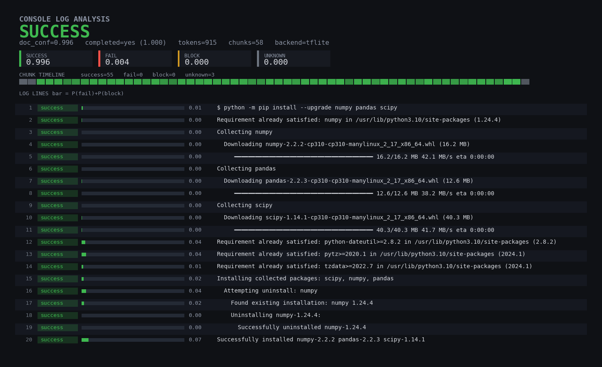
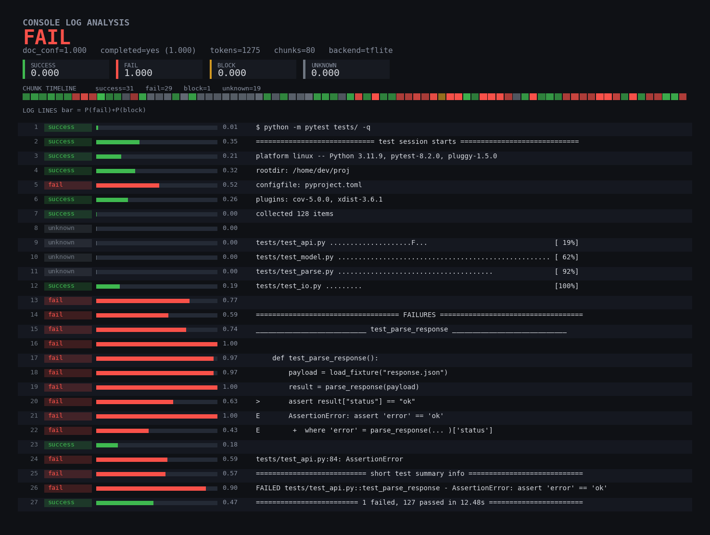
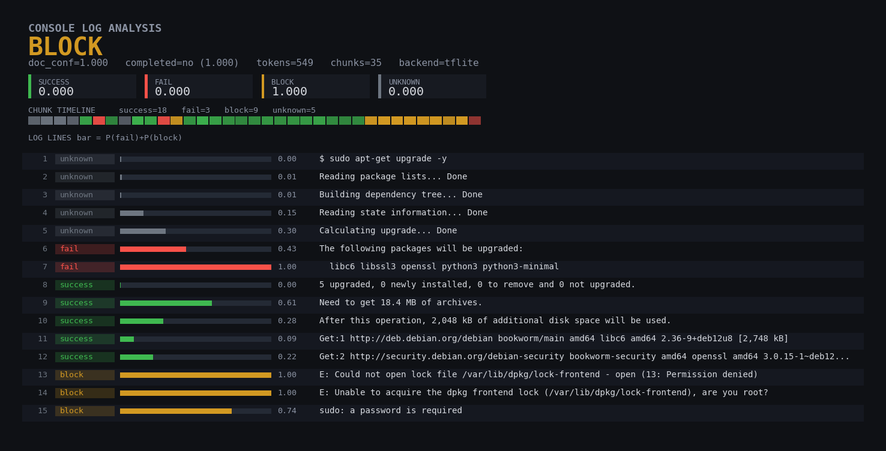
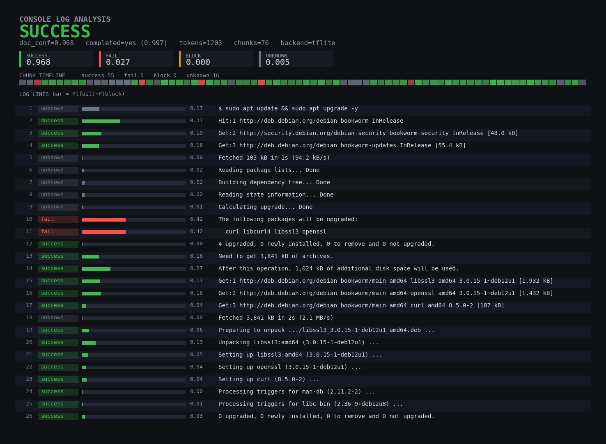

# console-nn

[](https://www.python.org/)
[](https://www.tensorflow.org/)
[](LICENSE)
[](tests/)

Length-unlimited console-log classification with a small fully-convolutional
network. The model labels 16-token chunks (`success` / `fail` / `block` /
`unknown`), pools them into a document verdict, and predicts whether the
operation reached a terminal state.

The int8 TFLite model accepts `[1, C, 16]` with dynamic `C`; Keras processes the
whole document. No recurrent or attention state. CPU-first.

```python
from console_nn import analyze

result = analyze(open("build.log").read(), tflite=True)
print(result.status, result.confidence, result.completed)
print(result.to_brief())
```

## Results

All three checkpoints were retrained on the deduplicated mixed corpus. `cpu`
and `rms` stopped after 10 and 8 epochs; `base` ran 10 epochs.

| variant | vocab | params | fp32 | int8 | float doc | int8 doc | int8 chunk | latency / 2048 tokens |
|---|---:|---:|---:|---:|---:|---:|---:|---:|
| `base` | 5000 | 506,953 | 1.93 MB | 600 KB | **99.30%** | **99.30%** | 68.30% | 10.292 ms |
| `cpu` | 3000 | 138,665 | 0.53 MB | **180 KB** | 98.80% | 98.80% | 66.92% | **2.152 ms** |
| `rms` | 3000 | 163,305 | 0.62 MB | 220 KB | 98.98% | 98.93% | 65.99% | 5.782 ms |

- CPU: AMD Ryzen 7 5700X, 4 TFLite threads, 200 iterations.
- `cpu`: 10 epochs, 245.8 s training, 951k tokens/s at inference.
- Real/curated held-out test (85 sessions): **90.59% document accuracy**,
  77.57% macro-F1, 57.37% chunk accuracy, 87.06% completion accuracy.
- Metrics: `results/<variant>/metrics.json`; the full training log is written
  to `artifacts/<variant>/run.log` locally.

## Examples

Each visual example is one log and one generated PNG:

| success: pip install | failure: pytest |
|---|---|
| [](examples/logs/01-pip-install-success.log) | [](examples/logs/02-pytest-failure.log) |

| blocked: apt lock | failure: cargo build |
|---|---|
| [](examples/logs/03-apt-block.log) | [](examples/logs/04-cargo-build-failure.log) |

| success: package update | success: ffmpeg processing |
|---|---|
| [](examples/logs/05-apt-upgrade-success.log) | [](examples/logs/06-ffmpeg-processing.log) |

Code examples: `examples/quickstart.py`, `batch.py`, `int8_vs_float.py`,
`command_capture.py`, `custom_model.py`, `streaming.py`, `cli_usage.sh`.
`examples/corpora/commands/` contains 20 complex sessions;
`examples/corpora/real/` contains 23 concrete Linux/Windows error sessions.

Generate a report:

```bash
python -m console_nn predict -f examples/logs/02-pytest-failure.log \
    --format png --out report.png
```

## Install

Requires Python 3.10+ and TensorFlow 2.x. TensorFlow is installed separately.

```bash
git clone https://github.com/zerettezer/console-nn
cd console-nn
pip install -e .
```

## API

```python
from console_nn import analyze, ConsoleAnalyzer

result = analyze(text)                 # Keras, default CPU model
result = analyze(text, tflite=True)    # int8 TFLite, any length

result.status          # success | fail | block | unknown
result.completed       # terminal state reached?
result.confidence
result.probs           # per-class probabilities
result.chunks          # per-chunk predictions
result.lines           # per-line predictions and severity
result.to_brief()      # verdict + high-severity lines
result.to_ascii()      # timeline + all lines
result.to_png("report.png")
result.to_json("report.json")
```

Specific checkpoint:

```python
analyzer = ConsoleAnalyzer(model_dir="console_nn/pretrained/rms", tflite=True)
result = analyzer.analyze_file("run.log")
result = analyzer.analyze_command("make -j8")
```

Streaming a growing log keeps model state for completed chunks instead of
re-analyzing the whole buffer:

```python
stream = ConsoleAnalyzer().stream()
for chunk in output_chunks:
    result = stream.feed(chunk)       # verdict over completed lines
result = stream.flush()               # commit the unfinished line
print(stream.last_latency_ms, stream.mean_chunk_latency_ms)
print(stream.measure_chunk_latency())  # median one-chunk + doc-head cost
```

The float Keras backend updates chunk features and document pools
incrementally. The int8 TFLite graph exposes only final outputs, so that
backend falls back to re-analysis of committed lines.

## CLI

```bash
python -m console_nn predict -f run.log --format png
python -m console_nn predict -f run.log --format brief
python -m console_nn predict --exec "make -j8" --format png --out build.png

python -m console_nn synth --out data/synth
python tools/build_curated_corpus.py
python tools/build_mixed.py
python -m console_nn train --config configs/cpu.json --data data/mixed --out artifacts/cpu
# cap one process when several GPU jobs run in parallel
CONSOLE_NN_GPU_MEMORY_MB=6000 python -m console_nn train --config configs/cpu.json --data data/mixed --out artifacts/cpu

python -m console_nn quantize --run artifacts/cpu --data data/mixed --mode int8
python -m console_nn validate --run artifacts/cpu --data data/mixed --split test --strict
python -m console_nn benchmark --run artifacts/cpu --iters 200 --threads 4 --save
python -m console_nn report --run artifacts/cpu --clean
python -m console_nn manifest --run artifacts/cpu
python -m console_nn doctor --run artifacts/cpu --data data/real --strict
python -m console_nn models --json

python tools/eval_domain_holdout.py --data data/mixed --out artifacts/cpu/domain_holdout.json
python -m console_nn baseline --run artifacts/cpu --data data/mixed --real data/real
python -m console_nn ablate --config configs/cpu.json --data data/mixed --real data/real
python -m console_nn calibrate --run artifacts/cpu --data data/mixed --real data/real --requantize --validate
python -m console_nn contrast --run artifacts/cpu --data data/mixed
python -m console_nn stream -f run.log --chunk 256 --json
```

## Architecture

```
tokens [B, C, 16]

ALBERT-style embedding: V×E gather → E×H projection → +16 intra-chunk positions
→ norm/dropout → pad mask
[B*C, 16, H]

dilated depthwise-separable Conv1D blocks
kernel 3, dilations 1/2/4(/8), GLU or ReLU, residual,
LayerNorm/BatchNorm/RMSNorm, dropout
masked mean+max pooling per 16-token chunk
chunk head: Dense(4) → [B, C, 4]

document pooling: masked mean+max over chunk features
+ mean+max over chunk probabilities
document head: Dense(4) → [B, 4]
completion head: Dense(1) → sigmoid
```

- ANSI is stripped, `\r` progress bars are collapsed, paths/IPs/timestamps/UUIDs
  are normalized. Numbers are digit-tokenized (`8080` → `<NUM> <8> <0> <8>
  <0>`), so values remain distinguishable.
- Word n-grams `1..3`; vocabulary cap 5000 (`base`) or 3000 (`cpu`/`rms`);
  specials `[PAD] [UNK] [BOS] [EOS] [SEP] [MASK]`; optional OOV hash buckets.
- Streaming 16-token chunks; final chunk padded; `C` dynamic.
- 16 learned positions shared by every chunk.
- Padded chunks are masked in pooling and losses.
- Losses: masked sparse CE for chunks (padding `0`, classes `1..4`), sparse CE
  for the document, binary CE for completion.
- Keras: whole document. TFLite: dynamic `C`, one call per document.
  `inference.window_chunks > 0` is an optional RAM cap only.
- Batch size is configurable. Documents are padded to the longest item in a
  batch; use length bucketing/token budgets for large GPU batches.

## Data

```
data/synth/train.jsonl  36000 documents  10.19 lines avg
data/synth/val.jsonl     4500 documents  12.67 lines avg
data/synth/test.jsonl    4500 documents  15.73 lines avg
data/real/train.jsonl     243 sessions (141 collected + 102 curated)
data/real/val.jsonl        43 sessions (20 collected + 23 curated)
data/real/test.jsonl       85 sessions (40 collected + 22 curated + 23 examples)
data/mixed/                 deduplicated synthetic + real (36105 / 4532 / 4584)
```

Synthetic train status: success 12373, fail 12583, block 5836, unknown 5208.
Platforms: Linux 28981, Windows 16019. 51 domains.

Splits differ by construction:

- separate RNG seeds for train/val/test;
- longer context in val/test;
- the `commands` family uses plain commands in train, a 50/50 plain/complex
  mix in validation, and held-out complex commands in test;
- 20 complex command families, 23 concrete real errors, 20 generic error
  families, 20 modern language/orchestration/data-service families, plus
  `multi`/`multi_chain` sessions with 2–4 commands.

JSONL schema:

```json
{
  "id": "suc-000001",
  "split": "train",
  "source": "synthetic",
  "platform": "linux",
  "domain": "pip",
  "command": "python -m pip install numpy==2.2.2",
  "status": "success",
  "completed": true,
  "lines": [{"text": "...", "label": "success|fail|block|neutral"}]
}
```

Regenerate and mix:

```bash
python -m console_nn synth --config configs/cpu.json --out data/synth
python tools/collect_real.py
python tools/build_curated_corpus.py
python tools/ingest_real_examples.py
python tools/build_mixed.py
python -m console_nn dataset-stats --data data/mixed
```

`collect_real.py` runs safe local commands in a temporary workspace and writes
real train/val/test sessions. Real test is held out:

```bash
python -m console_nn eval --run artifacts/cpu --data data/real --split test
```

## Training

```
configs/base.json   5000 vocab, 507k params
configs/cpu.json    3000 vocab, 139k params, ReLU, no norm
configs/rms.json    3000 vocab, 163k params, RMSNorm
```

| variant | data | epochs | train time | float doc | float chunk | completion |
|---|---|---:|---:|---:|---:|---:|
| base | mixed | 10 | 830.6 s | 99.30% | 68.30% | 98.39% |
| cpu | mixed | 10 | 245.8 s | 98.80% | 66.92% | 97.86% |
| rms | mixed | 8 | 321.3 s | 98.98% | 65.99% | 98.34% |

```bash
python -m console_nn train --config configs/cpu.json --data data/mixed --out artifacts/cpu
python -m console_nn quantize --run artifacts/cpu --data data/mixed --mode int8
python -m console_nn validate --run artifacts/cpu --data data/mixed --split test --strict
```

`artifacts/<variant>/run.log` contains per-epoch loss/accuracy and final
test/int8/benchmark.

## Evaluation beyond the held-out split

The synthetic test split and the 91 real sessions both come from fixed
distributions. Four additional checks are produced by the commands below:

| check | command | result file |
|---|---|---|
| domain holdout | `tools/eval_domain_holdout.py` | `results/cpu/domain_holdout.json` |
| baselines and ablations | `console_nn baseline`, `console_nn ablate` | `results/cpu/baselines.json`, `results/cpu/ablations.json` |
| calibration and contrast | `console_nn calibrate`, `console_nn contrast` | `results/cpu/calibration.json`, `results/cpu/contrast.json` |
| real-test breakdown | `tools/audit_splits.py`, paired evaluation | `results/cpu/real_test.json`, `results/cpu/split_audit.json` |

The domain holdout removes one of seven command families, trains the CPU
configuration for three seeds, tests only on the unseen family and reports
bootstrap 95% document intervals. Baselines are a keyword regex and hashed
word 1..3-gram logistic regression; ablations remove digit tokens or the
factorized embedding. Calibration fits one temperature on validation NLL and
applies it to the final document `Dense(4)` weights, so the graph and op count
do not change. Contrast pairs share a command but have different labels; their
score is stored as `contrast_pair_acc` in `results/cpu/metrics.json`.
Committed summaries live in `results/`; `artifacts/` is the local build directory
and is intentionally ignored by git.

### Domain holdout

Seven families, 3 seeds each, 4 epochs x 250 steps, 1000 bootstrap samples. The held-out family is absent from train and validation.

| held-out group | docs | doc acc | 95% CI | completion | 95% CI |
|---|---:|---:|---|---:|---|
| python | 389 | 88.86% | 86.29% - 91.34% | 92.72% | 90.57% - 95.03% |
| build_package | 631 | 79.87% | 76.91% - 82.57% | 93.13% | 91.28% - 94.88% |
| system | 640 | 78.75% | 75.94% - 81.25% | 92.19% | 90.26% - 94.12% |
| data_infra | 1049 | 76.45% | 74.10% - 78.74% | 90.75% | 89.10% - 92.44% |
| windows_misc | 698 | 75.55% | 72.54% - 78.51% | 89.92% | 87.78% - 91.83% |
| language_ecosystems | 546 | 73.81% | 70.70% - 76.92% | 97.92% | 96.70% - 98.84% |
| orchestration | 631 | 68.09% | 65.03% - 71.26% | 90.81% | 88.48% - 92.71% |

Macro document accuracy across groups: **77.34%** (4584 held-out documents).
### Baselines and ablations

Baselines use the same train split; ablations use a same-budget control (`cpu`, 4 epochs x 250 steps, 3 seeds).

| method | params | synth doc acc | synth macro F1 | real doc acc | real macro F1 |
|---|---:|---:|---:|---:|---:|
| regex keywords | 0 | 67.39% | 56.63% | 84.71% | 62.51% |
| hashed word 1-3 gram LR | 32,772 | 96.79% | 96.64% | 88.23% | 74.61% |
| cpu FCN (10 epochs) | 138,665 | 98.95% | 98.83% | 90.59% | 77.57% |
| cpu control (4 epochs) | 138,665 | 98.31% +/- 0.17 pp | 98.17% | 89.80% | 78.74% |
| no digit tokens | 138,665 | 98.46% +/- 0.30 pp | 98.31% | 88.23% | 77.24% |
| no factorized embedding | 232,617 | 98.56% +/- 0.12 pp | 98.45% | 89.02% | 79.66% |

Same-budget control: synth 98.31%, real 89.80%.
### Calibration and contrast

- Temperature: **1.0846** on 4489 synthetic validation documents (NLL 0.03423 -> 0.03400).
- ECE synthetic val: 0.00314 -> 0.00320.
- ECE real val (n=43): 0.10901 -> 0.10705.
- Unknown risk-coverage: at unknown precision 96.57%, coverage 84.41% and selective risk 0.82%.
- int8 graph: 104 -> 104 ops (unchanged: True).
- int8 latency: 2.319 -> 2.300 ms per window.
- int8 gate after calibration: **PASS**.
- Contrast pairs: 500 same-command pairs; **contrast_pair_acc 97.60%**, verdict changed on 98.60% of pairs.
## Validation

`validate` compares float and int8 and reports document/chunk/completion
metrics, per-class precision/recall/F1, confusion matrices, agreement and
probability delta.

| variant | float doc | int8 doc | doc drop | int8 doc F1 | int8 chunk | int8 completion | chunk agreement | gate |
|---|---:|---:|---:|---:|---:|---:|---:|---:|
| base | 99.30% | 99.30% | 0.00 pp | 99.25% | 68.30% | 98.39% | 99.93% | PASS |
| cpu | 98.80% | 98.80% | 0.00 pp | 98.65% | 66.92% | 97.86% | 99.87% | PASS |
| rms | 98.98% | 98.93% | -0.05 pp | 98.88% | 65.99% | 98.34% | 99.80% | PASS |

Real/curated held-out (`data/real/test.jsonl`, 85 sessions):

| metric | value |
|---|---:|
| document accuracy | 90.59% |
| document macro F1 | 77.57% |
| chunk accuracy | 57.37% |
| completion accuracy | 87.06% |

The real split contains 2 `unknown` examples and mixes collected, curated and
example sessions, so macro-F1 is not directly comparable to the synthetic
score. These numbers are for the `cpu` checkpoint. Gate defaults:
document accuracy `>= 0.85`, drop `<= 0.10`; `--strict` returns non-zero on
failure.

### Evaluation caveats

- Real test has 85 documents. The CPU model gets **77/85** (90.59%, Wilson
  95% 82.51–95.15%); hashed n-gram logistic regression gets **75/85**
  (88.24%, 79.68–93.48%). McNemar exact `p = 0.625` (3 vs 1 discordant), so
  this split does **not** establish FCN superiority over the linear baseline.
- Real `unknown` support is only 2 documents; its per-class F1 (0.667) is not
  a useful estimate. Per-class real-test details are in
  `results/cpu/real_test.json`.
- Domain-holdout runs use 4 epochs x 250 steps, while the production CPU model
  uses 10 x 600. A full-data same-budget control scores 98.31% synthetic,
  versus 98.95% for the production model; the held-out run at 4 x 250 reaches
  77.34% macro. Budget is a confound, not the whole domain gap.
- Calibration risk-coverage is measured on the **synthetic validation** split
  (4489 documents). Real validation has only 43 documents; its ECE improves
  from 0.109 to 0.107 but is not a reliable basis for a production reject
  threshold.
- The pre-clean corpus had 24 train/test duplicates (17 synthetic, 4
  collected, 3 examples matching synthetic `real_errors`), 24 train/val
  duplicates and 93 within-train duplicates. The current `data/mixed` is
  deduplicated, curated commands no longer cross splits, and the model was
  retrained; `results/cpu/split_audit.json` now reports zero exact and zero
  command-level cross-split overlap.

### Budget control

The full-data same-budget control (`cpu`, 4 x 250, 3 seeds) reaches 98.31%
synthetic versus 98.95% for the production `cpu`; the difference is about
0.6 pp. The holdout result is therefore dominated by domain shift, although
the holdout budget itself is still lower than production.

## Deployment

```bash
python -m console_nn manifest --run artifacts/cpu
python -m console_nn doctor --run artifacts/cpu --data data/real --strict
```

`manifest` writes SHA-256 for `config.json`, `tokenizer.json`, `weights.h5` and
`model_int8.tflite`. `doctor` verifies hashes, loads the run, checks the dynamic
TFLite shape, executes one int8 invocation, runs smoke inference, checks the
int8 gate, and optionally evaluates `data/real`.

Artifact layout:

```
artifacts/cpu/          local build output (ignored)
  model/
    config.json
    tokenizer.json
    weights.h5
    model_int8.tflite
    manifest.json
  run.log
  metrics.json
  benchmark.json
  calibration.json
  contrast.json
  baselines.json
  ablations.json
  domain_holdout.json
```

Packaged models: `console_nn/pretrained/{base,cpu,rms}`. `MODEL_CARD.md`
documents intended use, failure modes and monitoring. Committed metric
summaries are in `results/`; full corpora and run directories stay local.

## Tests

```bash
python -m unittest discover -s tests -v
```

Current: **34 tests, OK**. Coverage: tokenizer budget/round-trip, digit
tokenization, chunk encoding/padding, model shapes and padded-logit safety,
ASCII/brief/PNG, artifact layout, dynamic TFLite input (`C=1/7/100`), API
classification, int8 validation, split profiles, real/mixed corpus contract,
20+ complex commands, 20+ real errors, manifest/doctor.

## Attribution

The problem formulation is inspired by
[`BalanovAN/verdict`](https://huggingface.co/BalanovAN/verdict): classifying the
semantic outcome of CLI tool calls from command output.

This repository is an independent implementation. It does not include Verdict
source code, weights, configuration files or test data.

The implementations differ:

| | Verdict | console-nn |
|---|---|---|
| model | hashed character/word n-grams + logistic regression | FCN with ALBERT-style factorized embeddings |
| input | command, exit code, stdout, stderr | command output text |
| exit code | model feature | not used |
| length | head/tail clipping | dynamic `C`, no fixed limit |
| outputs | document class | chunk, document and completion heads |

Verdict's model card states that its weights are Apache-2.0 and its data is
CC0. If any Verdict assets are reused, their license and notices apply.

```bibtex
@misc{balanov2026verdict,
  title  = {Verdict: Tiny Semantic Outcome Verification for AI Agents},
  author = {Balanov, Anton},
  year   = {2026},
  url    = {https://balanov.pro/research/verdict/}
}
```

## Operational constraints

Use `cpu` with int8 for CPU deployment. Keep the confidence score and the float
model available for high-risk gates; int8 and float disagree on borderline
documents.

- Synthetic data is still the majority of training. Real evaluation covers 91
  sessions; treat domain shift as a monitored risk. Add production logs to
  `data/real` and rerun `build_mixed.py`.
- `base`, `cpu` and `rms` use 10, 15 and 10 epochs respectively on the mixed
  corpus.
- Chunk F1 is lower than document accuracy: neutral lines in successful
  operations inherit `success`, while neutral chunks in failed operations stay
  `unknown`.
- `unknown` is the least reliable class. Reject low-confidence `unknown`
  results at the application layer when a decision is mandatory.
- Logs may contain secrets. Redact credentials before sending them to any
  external service; inference here is local.

## License

Apache-2.0. See [LICENSE](LICENSE).

## Layout

```
console_nn/             package
  api.py                public API
  tokenizer.py          n-gram + digit-token vocabulary
  synth.py              workflow generators and split profiles
  synth_extra.py        updates, compiles, media, data, database, cloud
  synth_commands.py     command catalogue
  synth_errors.py       generic error families
  synth_real_errors.py  concrete Linux/Windows errors
  synth_multi.py        multi-command sessions
  data.py               JSONL → chunks → tf.data
  model.py              embedding, FCN, heads, losses
  engine.py             dynamic-length Keras/TFLite inference
  stream.py             incremental streaming analyzer
  train.py              training
  evaluate.py           metrics/run loading
  int8_validation.py    int8-vs-float validation
  quantize.py           int8 TFLite export
  benchmark.py          CPU latency
  domain_holdout.py     seven-family holdout evaluation
  baselines.py          regex / hashed n-gram baselines and ablations
  calibration.py        temperature, ECE, risk-coverage
  contrast.py           same-command contrast pairs
  reporting.py          log/metrics/benchmark consolidation
  doctor.py             manifest + deployment checks
  viz.py                ASCII/brief/matplotlib PNG
  cli.py                command line
  pretrained/           base/ cpu/ rms/
configs/                training configs
results/                committed metric summaries (base/ cpu/ rms/)
artifacts/              local build output, ignored by git
data/synth/             45k synthetic corpus
data/real/              collected + curated real sessions
data/mixed/             synthetic + real
examples/               usage code + logs/ + corpora/
tools/                  real collector, curated builder, mixed builder, domain holdout, split audit
MODEL_CARD.md           intended use and failure modes
tests/                  unittest suite
```
